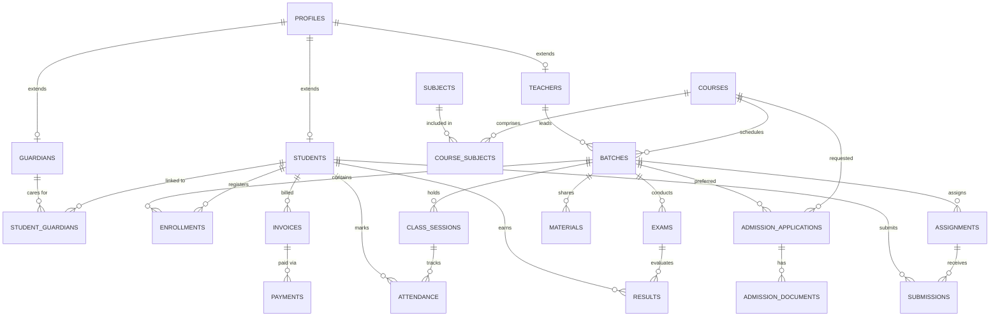

# Aurora Academic Care — Database Schema & Architecture

This document describes the 30 normalized tables designed for Aurora Academic Care, supporting hybrid coaching management, multi-step admissions, examination/GPA calculation (Bangladesh 5.0 scale), attendance, and SSLCOMMERZ payment processing.

---

## 1. Entity-Relationship Overview

---

## 2. Table Specifications (30 Normalized Tables)

| # | Table Name | Purpose | Primary Key | Foreign Keys / Key Attributes |
|---|---|---|---|---|
| 1 | `profiles` | User accounts | `id` (UUID) | References `auth.users(id)` |
| 2 | `students` | Enrolled student profiles | `id` (UUID) | `profile_id`, `student_id_code` (Unique) |
| 3 | `teachers` | Faculty & mentors | `id` (UUID) | `profile_id`, `department`, `designation` |
| 4 | `guardians` | Parents/Guardians | `id` (UUID) | `profile_id`, `occupation` |
| 5 | `student_guardians` | Child-Guardian link | `id` (UUID) | `student_id`, `guardian_id` |
| 6 | `subjects` | Curricula subjects | `id` (UUID) | `code`, `name_en`, `name_bn` |
| 7 | `courses` | Academic programs | `id` (UUID) | `slug`, `fee`, `learning_mode` |
| 8 | `course_subjects` | Course-Subject link | `id` (UUID) | `course_id`, `subject_id` |
| 9 | `batches` | Scheduled cohorts | `id` (UUID) | `course_id`, `lead_teacher_id`, `code` |
| 10 | `enrollments` | Active batch enrollments | `id` (UUID) | `student_id`, `batch_id`, `roll_number` |
| 11 | `admission_applications` | Online admissions | `id` (UUID) | `application_reference` (Unique), `status` |
| 12 | `admission_documents` | Verification documents | `id` (UUID) | `application_id`, `file_url` |
| 13 | `class_sessions` | Routine & meeting links | `id` (UUID) | `batch_id`, `meeting_link` (Protected) |
| 14 | `attendance` | Daily attendance log | `id` (UUID) | `session_id`, `student_id`, `status` |
| 15 | `exams` | Assessment tests | `id` (UUID) | `batch_id`, `exam_type`, `total_marks` |
| 16 | `exam_subjects` | Subject mark distribution | `id` (UUID) | `exam_id`, `subject_id` |
| 17 | `results` | Student marksheets | `id` (UUID) | `exam_id`, `student_id`, `grade_point` |
| 18 | `grading_rules` | Bangladesh standard 5.0 | `id` (UUID) | `grade` (A+, A, A-, B, C, D, F) |
| 19 | `invoices` | Tuition & exam fees | `id` (UUID) | `invoice_number`, `student_id`, `status` |
| 20 | `payments` | Gateway ledger | `id` (UUID) | `transaction_id`, `gateway_val_id` |
| 21 | `payment_webhook_events` | IPN idempotency | `id` (UUID) | `transaction_id`, `is_processed` |
| 22 | `expenses` | Campus operational costs | `id` (UUID) | `amount`, `category`, `approved_by` |
| 23 | `notices` | Bulletin board notices | `id` (UUID) | `category`, `target_role`, `is_pinned` |
| 24 | `materials` | Lecture PDFs & notes | `id` (UUID) | `batch_id`, `file_url` |
| 25 | `assignments` | Homework & problem sets | `id` (UUID) | `batch_id`, `due_date` |
| 26 | `submissions` | Student homework | `id` (UUID) | `assignment_id`, `student_id` |
| 27 | `notifications` | In-app alerts | `id` (UUID) | `user_id`, `is_read` |
| 28 | `support_tickets` | Queries & grievances | `id` (UUID) | `user_id`, `status` |
| 29 | `site_settings` | Admin CMS configurations | `id` (UUID) | `setting_key`, `setting_value` (JSONB) |
| 30 | `audit_logs` | Security compliance | `id` (UUID) | `user_id`, `action`, `ip_address` |

---

## 3. Bangladesh National Board Grading Rules

| Letter Grade | Percentage Score | Grade Point (GPA) | Assessment Remarks |
|---|---|---|---|
| **A+** | 80% — 100% | 5.00 | Outstanding |
| **A** | 70% — 79% | 4.00 | Excellent |
| **A-** | 60% — 69% | 3.50 | Very Good |
| **B** | 50% — 59% | 3.00 | Good |
| **C** | 40% — 49% | 2.00 | Satisfactory |
| **D** | 33% — 39% | 1.00 | Pass |
| **F** | 0% — 32% | 0.00 | Fail |

*Note: In Bangladesh Board standards, scoring an F in any mandatory subject results in an overall GPA of 0.00.*
